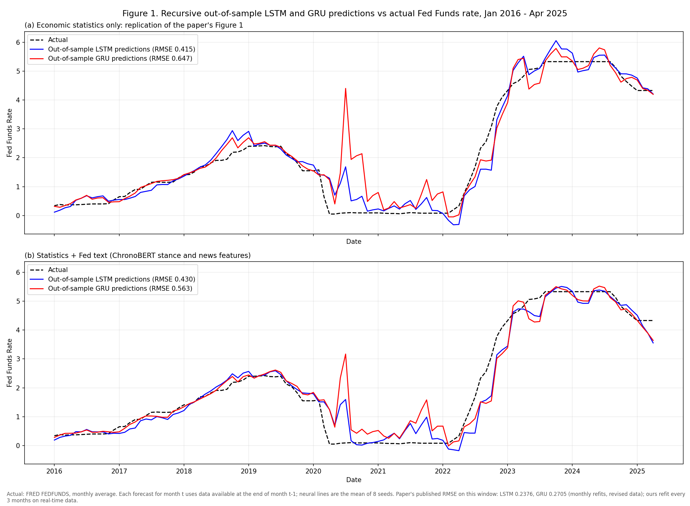
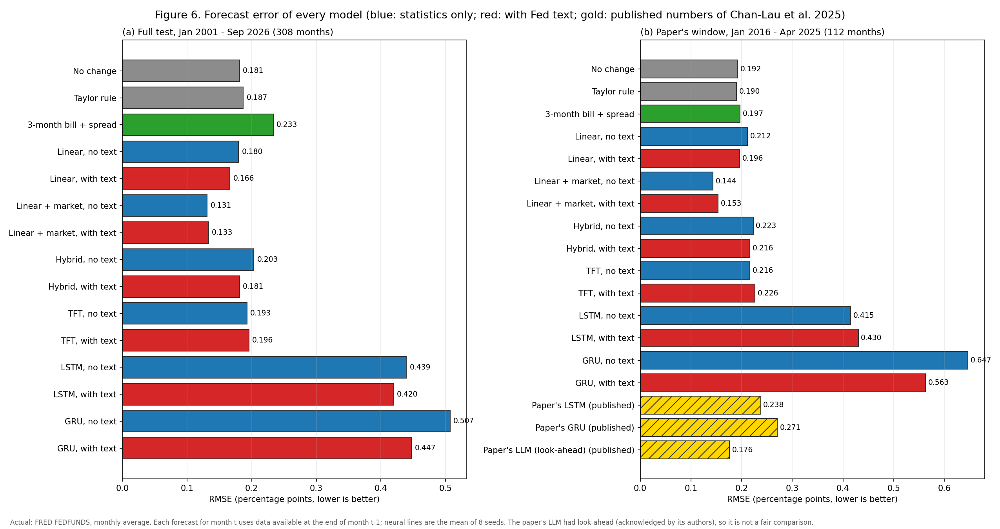

# Fed News Forecasting: does Federal Reserve text help forecast the federal funds rate?

A pre-specified, look-ahead-controlled study of whether the text of Federal Reserve communication, read by a
time-consistent language model (ChronoBERT), improves forecasts of the US federal funds rate, and whether
deep-learning models (LSTM, GRU, Temporal Fusion Transformer) beat simple linear models. It attempts to replicate
and then extends Chan-Lau, Quach and Shi (2025, AMRO WP/25-10); the replication of their LSTM and GRU accuracy
did not succeed (section 11).

**Short answer.**

- **Fed text: inconclusive.** Adding text lowers forecast error in 6 of 11 model-task pairs (sign test p = 0.5).
  No pre-registered test passes (linear: p = 0.077 monthly, 0.061 per meeting, 0.23 for decisions; neural: 0 of
  10 after Holm; event studies: p = 0.129 and 0.369), and the linear gain shrinks when the text classifier is
  retrained. The design had low power for gains of this size, so this is not evidence that text has no effect.
- **Replication: not achieved.** On the paper's window (Jan 2016 - Apr 2025) our real-time LSTM and GRU have RMSE
  0.415 and 0.647. The paper exists in two versions: the September 2025 AMRO working paper (WP/25-10, Table 2)
  reports 0.1868 (LSTM) and 0.2672 (GRU); the July 2025 preliminary SSRN version (5401236) reports 0.2376 and
  0.2705. A no-change forecast (0.192) beats the GRU in both versions and the preliminary LSTM, but not the working
  paper's LSTM (0.1868). The paper's LLM (0.176) beats no change, but its authors acknowledge it had look-ahead.
  Our own linear model with text (0.196) also loses to no change on that window.
- **Linear vs deep (exploratory).** Our linear model significantly outperforms our LSTM, GRU and meeting-LSTM
  set-ups, which are weak here (the meeting LSTM calls 32% of decisions correctly, against 66% for "always
  hold"). Against the TFT without text, its lead is not significant (p = 0.14).
- **Market rates are the best predictor** (monthly RMSE 0.131), and text adds nothing on top of them.

| Study | Question | Status / verdict | Key numbers |
|---|---|---|---|
| Plan 1 (H1, tag `prereg`) | Does text help the primary linear models? | Not supported | Monthly RMSE 0.180 to 0.166 (-7.5%), one-sided DM p = 0.077; per meeting p = 0.061; decisions p = 0.23 |
| Plan 2 (H2a, tag `prereg-h2a`) | Does text help LSTM, GRU, TFT and a hybrid? | Not supported | 0 of 10 tests significant after Holm; hybrid raw p = 0.008 / 0.011 |
| Plan 3 (H2b, H2e, H2f, H2g) | LLM readers and a re-run of the paper's LLM | **Registered, not run** | See section 10 |
| Plan 4 (`replication-market` spec) | Explain the replication gap; market-based extension | **Designed, never registered or run** | See section 10 |
| Plan 5 (H5, tag `prereg-text`) | Does the stance surprise of each Fed release predict the same-day 2-year yield move? | Not supported | Clark-West p = 0.129 on 1,778 event days |
| Study 2 (H6, tag `prereg-study2`) | Same, adding 3,562 regional Fed presidents' speeches and a retrained classifier | Not supported | Clark-West p = 0.369 on 3,158 event days |

Full reports: [`RESULTS.md`](RESULTS.md), [`RESULTS_H2A.md`](RESULTS_H2A.md), [`RESULTS_FROZEN.md`](RESULTS_FROZEN.md),
[`RESULTS_TEXT.md`](RESULTS_TEXT.md), [`RESULTS_STUDY2.md`](RESULTS_STUDY2.md),
[`RESULTS_STUDY2_FROZEN.md`](RESULTS_STUDY2_FROZEN.md). Every change after a pre-specification is listed in
[`DEVIATIONS.md`](DEVIATIONS.md). Figures: [`figures/`](figures/). How the work was done, including the use of
an AI coding agent: section 10.

---

## Contents

1. [What is forecast](#1-what-is-forecast)
2. [Repository layout](#2-repository-layout)
3. [Data](#3-data)
4. [Reading the Fed's tone: the ChronoBERT stance classifier](#4-reading-the-feds-tone-the-chronobert-stance-classifier)
5. [Input features](#5-input-features)
6. [Models and how they are trained](#6-models-and-how-they-are-trained)
7. [Event studies (H5, H6)](#7-event-studies-h5-h6)
8. [Exploratory analyses](#8-exploratory-analyses)
9. [Statistical tests](#9-statistical-tests)
10. [Pre-specification, what was not run, and how the work was done](#10-pre-specification-what-was-not-run-and-how-the-work-was-done)
11. [Results](#11-results)
12. [Figures](#12-figures)
13. [Reproducing the study](#13-reproducing-the-study)
14. [Limitations and residual look-ahead](#14-limitations-and-residual-look-ahead)
15. [References](#15-references)

---

## 1. What is forecast

| Task | Target | Information set | Test window |
|---|---|---|---|
| **T1, monthly** | FRED `FEDFUNDS`, the monthly average effective federal funds rate, in month t | Statistics, market data and text available at the start of month t. The lagged rate FEDFUNDS(t-1) is only published on the first business day(s) of month t, so it carries 1-3 days of look-ahead, shared by every model including no change (the original paper's protocol). Models are trained on rows up to t-2 | Jan 2001 - Sep 2026, 308 months (Jan 2004 dropped for missing data); the paper's window Jan 2016 - Apr 2025 is also reported |
| **T2, per meeting** | The target rate set at each FOMC meeting (midpoint of the target range) and its class: cut / hold / hike, using a +/-0.125 percentage-point band | Data dated before the meeting; models trained on earlier meetings only | 212 meetings, Jan 2001 - Sep 2026, including 6 unscheduled moves (the full set from 1994 has 270 meetings, 8 of them unscheduled) |
| **Events** | Change in the 2-year Treasury yield (FRED `DGS2`, basis points) from the previous trading day to the event's outcome day | The regressor is the stance of the event's **own same-day documents** relative to documents from the previous 30 days; the model's coefficients are estimated on earlier events only | 1,778 (H5) and 3,158 (H6) event days, 2001 - 2026 |

All series start in January 1994. Rows before 2001 are used for training only.

---

## 2. Repository layout

The code was regrouped by purpose on 2026-10-17 (branch `review-layout`). **Start with
[`docs/REVIEW_MAP.md`](docs/REVIEW_MAP.md)**: it traces one forecast from raw source to reported p-value, gives the
run order, and maps every headline number to its prediction file, code, test, data-vintage treatment, commit and
status. Old module names such as `fed_news.walkforward` or `python -m fed_news.tune` still work (they load the
moved module; see `src/fed_news/__init__.py`).

```
src/fed_news/
  config.py, http.py        paths (data root D:/fed_news or FED_NEWS_DATA), fixed settings; cached HTTP
  collect/                  raw sources -> dated tables
    market.py, alfred.py      daily market series; ALFRED real-time vintages
    fomc_calendar.py, meetings.py   FOMC calendar pages; meeting set and decisions
    corpus.py, indices.py     Fed text corpus with release dates; SF Fed / GPR / EPU indices
    labels.py                 stance labels, dated by their source document
    fraser.py, regional_corpus.py   Study 2 regional speeches
  features/                 stance scores and feature panels
    stance.py                 per-year ChronoBERT classifiers, document stance (C)
    haiku_index.py            Claude Haiku 5.5 sentence labels, document stance (H)
    text_features.py          the six Plan 1 news columns (N)
    panel.py                  T1 / T2 panels: targets, S and M blocks, cutoffs (t1, t1b, t2)
  models/                   shared model code
    linear.py                 ridge, ordered logit, Taylor rule, penalty CV (was models.py)
    walkforward.py            linear walk-forward engine, ladder, placebo and shuffled controls
    neural.py, tft.py         LSTM / GRU regressors and training loops; TFT-inspired network
  evaluation/               metrics and tests shared by all studies
    stats_tests.py            DM-HLN, exact McNemar, Holm
    evaluate.py               metrics, Plan 1 H1 decision, RESULTS.md
    clark_west.py, robustness.py, plots.py
  studies/
    plan1_linear/             run_models.py (Plan 1 ladder)
    plan2_neural_original/    ORIGINAL networks (H2a): neural_walk, run_neural, evaluate_h2a, frozen, diag_tft
    plan5_event_study/        events, event_study, naive_stance, ablation, market_bench, evaluate_text
    study2_regional/          stance2, study2, study2_frozen, evaluate_study2
    study3_decision_text/     decision_embed, decision_text, study3, evaluate_study3 (proof of concept)
    study4_haiku_logit/       haiku_compare (Study 4 primary), study4_sensitivity
    study4_networks_v2/       AMENDED networks (Study 4 v2): tune, verify_v2, study4_pooled
    study5_horizon/           study5
    poc/                      2026-10-12 proofs of concept (statement change, scorers, Haiku leak/memory)
tests/                      unit tests (pytest), one file per module; test_layout.py checks the old names
results/                    all forecasts, metrics and test tables (each study folder has a README label)
audit/                      2026-10-13 audit; verify_saved_outputs.py re-runs the linear ladders read-only
paper/                      draft paper (main.tex, refs.bib, figures, make_figures.py)
docs/                       REVIEW_MAP.md, RESULTS_PROVENANCE.md, design specs and plans (docs/superpowers/)
PREREG*.md, RESULTS*.md     pre-specifications and generated reports (kept at the root, where the tags have them)
DEVIATIONS.md               every deviation, erratum and post-results note
```

Raw data, caches and API keys live outside the repository (default `D:/fed_news`); see section 13.

---

## 3. Data

| Block | Content | Source |
|---|---|---|
| **S: statistics (16)** | Lagged policy rate; M2 (monthly and 12-month change); PCE and core PCE inflation; payroll change; average weekly earnings; nominal GDP growth; U-6 (monthly and 12-month change); PPI; CPI and core CPI; FHFA house prices; 10y-2y and 1y-6m yield slopes. The paper's Table 1 without the commercial property index (no free equivalent); the CRB index replaced by PPI | FRED / **ALFRED real-time vintages** (Croushore and Stark, 2001): each value is the latest vintage released strictly before the forecast cutoff |
| **N: news (6)** | Fed stance, change in Fed stance, Beige Book tone, newspaper sentiment, geopolitical risk, policy uncertainty | See sections 4-5 |
| **M: market (8)** | 3-month bill, 6-month, 1-year and 2-year yield spreads to the target; target level; zero-lower-bound flag; VIX; WTI oil | FRED daily series as of the cutoff |
| **Fed text** | 2,840 documents: 240 statements, 263 minutes, 94 press-conference transcripts, 262 Beige Books, 1,981 Board speeches | federalreserve.gov (FOMC calendar, Beige Book archives, speech lists) |
| **Regional speeches (Study 2)** | 3,562 speeches of regional Federal Reserve Bank presidents within their tenure years: 3,437 from FRASER, 125 from BIS | St. Louis Fed FRASER REST API (35 speech series titles); BIS central bankers' speeches |
| **Labels** | Hawkish / dovish / neutral sentences: Trillion Dollar Words (Shah, Paturi and Chava, 2023) and the Federal Reserve subset of the World Central Banks dataset (Shah et al., 2025) | Hugging Face `gtfintechlab` |

**Real-time rule and its gaps.** Where ALFRED has no vintage, the earliest vintage with a conservative release
lag is used; those values include later revisions. First vintages start in 2011 for average weekly earnings and
U-6 and in 2012 for FHFA house prices (PREREG.md). As a result, **136 of 308 monthly test rows and 96 of 212
meeting test rows (44-45%) use at least one revised value** (`results/exploratory/fallback_rows.csv`). The
revised values enter every model identically, so they cannot favour the text models, but forecasts in those
rows are not fully real-time.

**Label dating.** The published `year` field of Trillion Dollar Words does not always match the document
date, which would leak future labels. Each label is therefore dated by the earliest corpus document that
contains it. 89.3% of Trillion Dollar Words and 98.3% of World Central Banks sentences matched; **the unmatched
10.7% and 1.7% are dropped** (`labels.date_labels`).

---

## 4. Reading the Fed's tone: the ChronoBERT stance classifier

**Why ChronoBERT.** Standard language models have read text written after the events being forecast, which can
inflate back-tested accuracy (Eliseev and Seleznev, 2026). ChronoBERT (He, Lv, Manela and Wu, forthcoming)
releases one model per year, each trained only on text published up to 31 December of that year, which removes
this source of look-ahead from the language model itself.

**Training (per classifier year y, from 2000):**

| Setting | Value |
|---|---|
| Backbone | `manelalab/chrono-bert-v1-{y-1}1231` (trained on text up to the end of year y-1; 2025-2026 use the 2024 vintage) |
| Head | mean-pooled last hidden state, then a linear layer with 3 outputs (dovish, hawkish, neutral) |
| Training labels | all labels whose source document is dated before 1 January of year y |
| Optimiser | AdamW, learning rate 2e-5, weight decay 0.01, gradient clipping at 1.0, fp16 autocast |
| Epochs, batch, length | 3 epochs, batch 16, maximum 256 tokens |
| Seeds | 3 seeds (0, 1, 2); class probabilities averaged |
| Hold-out (Plan 1) | 20% of eligible labels held out (seeded random split) to report accuracy; the classifier that scores documents is trained on the other 80% |
| Study 2 change | the scoring classifier is trained on 100% of eligible labels |

**Accuracy and its caveats.** Held-out sentence accuracy rises from 0.56 (2000) to 0.70 (2025), median 0.655
([`results/stance_accuracy.csv`](results/stance_accuracy.csv)). Always predicting the most common class
("neutral") would score 0.42-0.56, so the classifier adds about 10-25 points
([`results/exploratory/stance_majority_baseline.csv`](results/exploratory/stance_majority_baseline.csv)). The
split is at the sentence level, so sentences from the same document or meeting can appear in both training and
hold-out sets; the reported accuracy is therefore likely optimistic. The labels themselves were written by
annotators in 2023-2025, with hindsight (section 14).

**Scores.** Documents are split into sentences of 30-1000 characters. Sentence stance =
P(hawkish) - P(dovish); document stance = mean over its sentences. Documents of year y are scored only by the
classifier of year y; documents from 1994-1999 are scored by the year-2000 classifier and are used only for
training rows.

---

## 5. Input features

The six news features N, computed per row from documents released before the row's cutoff:

| Feature | Definition (T2: window since the previous meeting; T1: month t-1) |
|---|---|
| `n_stance` | Mean of three group means: statements plus press conferences, minutes, speeches (empty groups skipped); carried forward when no documents |
| `n_stance_chg` | Change in `n_stance` from the previous row |
| `n_beige` | Loughran-McDonald net tone (pos - neg) / (pos + neg) of the latest Beige Book before the cutoff |
| `n_news` | SF Fed daily news sentiment, mean over the 30 days ending three days before the cutoff |
| `n_gpr` | Log geopolitical risk index (Caldara and Iacoviello, 2022), same window; values <= 0 treated as missing |
| `n_epu` | Log economic policy uncertainty index (Baker, Bloom and Davis, 2016), same window |

All features are standardised with the training rows' mean and standard deviation at each refit.

---

## 6. Models and how they are trained

### 6.1 Walk-forward protocol

Every model is re-estimated on an expanding window and forecasts only rows it has never seen:

- T1: the forecast for month t uses training rows up to month t-2 (`walkforward.train_mask`).
- T2: the forecast for a meeting uses earlier meetings only.
- Standardisation, penalty selection and early stopping all use training rows only.
- Penalties are chosen by five-fold expanding-window cross-validation inside each training window.

### 6.2 Benchmarks

- **No change / always hold:** next month's rate equals the last observed rate; the meeting keeps the rate. The random walk is the standard hard-to-beat benchmark for financial series (Meese and Rogoff, 1983).
- **Inertial Taylor rule** (Taylor, 1993): OLS of the rate on its lag, real-time core PCE inflation and real-time U-3 unemployment, walk-forward.

### 6.3 Primary linear models (Plan 1)

- **T1:** ridge regression on the monthly change in the rate; penalty grid of 7 log-spaced values from 0.1 to 1000. Forecast = last rate + predicted change.
- **T2:** penalised ordered (cumulative) logit for cut < hold < hike, written with `scipy.optimize`, L2 penalty on slopes from {0.01, 0.03, 0.1, 0.3, 1, 3}. The rate forecast is the standing target plus the probability-weighted mean move (mean move sizes per class from the training window, hold = 0); the class forecast is the most probable class.
- Each is run with S, S+N, S+M and S+M+N, plus a placebo (text features permuted across rows inside each training window) and a shuffled-label control (training targets permuted).

### 6.4 Deep-learning models (Plan 2)

All neural models: Adam optimiser, mean squared error on **standardised targets** (inverted at prediction),
8 seeds (0-7; initialisation and batch order), ensemble = mean of the 8 seeds' forecasts.

| Model | Architecture | Training | Refit |
|---|---|---|---|
| **Paper LSTM** (T1) | 1-layer LSTM, 240 units, 12 monthly steps, no dropout, linear output | lr 1e-4, 300 epochs, batch 32 shuffled per epoch (seeded); predicts the rate **level** | every 3 months (pre-registered one-hour rule: one GRU seed-pass with monthly refits took > 3,600 s; the paper refits monthly) |
| **Paper GRU** (T1) | 1-layer GRU, 188 units, 12 steps | lr 2e-4, 449 epochs, batch 32; level | every 3 months |
| **Meeting LSTM** (T2) | as the paper LSTM, lookback 4 meetings | as the paper LSTM | every 8 meetings |
| **TFT** (T1, T2) | compact Temporal Fusion Transformer (below), hidden 32, 4 heads, dropout 0.2, lookback 12 months / 8 meetings | lr 1e-3, full batch, at most 300 epochs, early stopping on the last 20% of training rows with patience 20 (best epoch kept; untrained weights count as epoch 0); predicts the **change** | every 12 months / 8 meetings |
| **Hybrid** (T1, T2) | primary linear model (anchor, refit every row) + TFT correction | TFT trained on the anchor's out-of-fold residuals (5 expanding folds inside the training window; folds with fewer than 20 training rows skipped) | TFT every 12 months / 8 meetings |

The LSTM and GRU hyperparameters are those tuned by Chan-Lau, Quach and Shi (2025). Note that the LSTM and GRU
predict the level while the linear models and the TFT predict the change, so comparisons between them mix the
architecture with the choice of target.

**Compact TFT** ([`src/fed_news/models/tft.py`](src/fed_news/models/tft.py)), following Lim, Arik, Loeff and Pfister (2021):

```
input (batch, time, features)
  -> Variable Selection Network: per-variable GRNs + softmax weights over variables (per time step)
  -> LSTM encoder (hidden 32)
  -> gated skip connection (GLU) + layer norm
  -> interpretable multi-head attention (4 heads, shared value weights, averaged heads)
  -> gated skip connection + layer norm
  -> position-wise Gated Residual Network
  -> gated skip connection + layer norm
  -> linear head on the last time step -> point forecast (MSE)
```

GLU = gated linear unit; GRN = gated residual network (two dense layers, GLU, skip, layer norm). Static
covariate encoders and the known-future input path are omitted (the problem has no static variables), and the
quantile head is replaced by a point forecast so that the loss equals the LSTM's.

**Variance rule.** A neural gain counts only if mean RMSE(S) - mean RMSE(S+N) over the 8 seeds exceeds twice
the larger seed standard deviation (ddof 1).

### 6.5 Frozen models

Following the paper's counterfactual exercise, each model is trained once on data before 2016-01-01 (or
2020-01-01) and then forecasts every later month or meeting without updating. Reported next to the same
model's walk-forward forecasts over the same months (descriptive; not part of any decision).

---

## 7. Event studies (H5, H6)

**Events.** Each statement, set of minutes, press-conference transcript or speech is mapped to its *outcome
trading day*: the first date with a 2-year yield on or after its release day. All documents with the same
outcome day form one event, so weekend releases join the next trading day and no two events share an outcome.

**Regressor.** Stance surprise = event stance (mean of the event's own documents) minus the document-mean stance
of earlier events' documents released within the 30 calendar days before the outcome day (fallback: the mean
stance of the latest earlier event).

**Outcome.** 2-year yield change in basis points on the outcome day versus the previous trading day.

**Test.** Walk-forward OLS on all strictly earlier events (from 1994): small model `dy2 = a`, large model
`dy2 = a + b * surprise`; one-sided Clark-West test; supported if p < 0.05. **Void rule:** the same test on
the previous trading day's yield change must not be significant (leakage check).

**Size of the effect.** The full-sample slope is 3.4 bp per unit of surprise (H5), but the surprise has a
standard deviation of only 0.059, so one standard deviation moves the 2-year yield by about **0.20 bp** (H5) and
**0.12 bp** (H6), against a daily standard deviation of about 5.8 bp
([`results/exploratory/event_slope_per_sd.csv`](results/exploratory/event_slope_per_sd.csv)).

**What is not controlled.** There is no control for the policy-rate surprise on FOMC decision days, and no
fed funds futures benchmark (Gurkaynak, Sack and Swanson, 2007). Speech-only days, which carry no rate
decision, are reported separately and are also null (H6 speeches: p = 0.586).

**Study 2** adds FRASER and BIS speeches of the presidents of the 12 regional Federal Reserve Banks
(within their tenure years; FRASER preferred on duplicates; speeches duplicating a Board speech dropped) and
re-scores every document with classifiers trained on all eligible labels.

---

## 8. Exploratory analyses

None of these was pre-registered; each was chosen after earlier results were known, and none changes a
pre-registered verdict.

- **Clark-West for nested models** (linear S vs S+N): p = 0.021 (monthly) and 0.001 (per meeting) with the Plan 1 classifier; p = 0.086 and 0.119 with the Study 2 classifier ([`results/exploratory/clark_west.csv`](results/exploratory/clark_west.csv)).
- **Look-ahead comparison:** ModernBERT-base fine-tuned on all labels at once (deliberate look-ahead). Its pipeline looked significant (monthly DM p = 0.043; event study p = 0.048), but the direct test of ModernBERT against ChronoBERT was not significant (p = 0.055, 0.40, 0.136), and the two pipelines differ in at least four ways (model, label dating, label count, training-scoring overlap).
- **Market benchmark:** Treasury-bill yield plus a training-window spread (3-month and 4-week bills). Descriptive.
- **Feature ablation:** S plus each text group, and S+N minus each group (12 unadjusted comparisons).
- **TFT diagnostic:** early stopping kept the untrained weights in 21-25% of TFT refits and 32-45% of hybrid refits, so many TFT forecasts are close to the untrained network's output.

Added after an external review ([`src/fed_news/evaluation/robustness.py`](src/fed_news/evaluation/robustness.py), outputs in
`results/exploratory/`):

- **Linear vs deep** (`linear_vs_neural.csv`): one-sided DM tests that the linear model beats each neural ensemble with the same inputs. Linear beats LSTM, GRU, meeting LSTM and hybrid at p < 0.001 in all comparisons, and the TFT at p < 0.001 except monthly without text (p = 0.144). Caveats: the LSTM/GRU predict levels while the linear models predict changes; the meeting LSTM is worse than "always hold"; the TFT often kept untrained weights; the paper LSTM/GRU were refit every 3 months, not monthly. These comparisons say our deep set-ups are weak here, not that deep learning cannot work.
- **Sign count** (`text_sign_test.csv`): text lowers RMSE in 6 of 11 model-task pairs (including the two market models, where text raises RMSE); one-sided sign test p = 0.5.
- **Excluding the zero lower bound** (`ex_zlb.csv`): on rows whose last observed rate is above 0.25 (199 months, 140 meetings), text lowers linear RMSE from 0.192 to 0.188 (monthly; DM p = 0.165, Clark-West p < 0.001) and from 0.237 to 0.228 (per meeting; DM p = 0.027, Clark-West p = 0.002). This subsample was chosen after the review and is one of many exploratory cuts, so it is suggestive at most.

---

## 9. Statistical tests

| Test | Use | Reference |
|---|---|---|
| Diebold-Mariano with the Harvey-Leybourne-Newbold small-sample correction, one-sided, horizon 1 | squared-error comparisons (H1, H2a) | Diebold and Mariano (1995); Harvey, Leybourne and Newbold (1997) |
| Exact McNemar test on discordant pairs, one-sided | correct cut / hold / hike classes | McNemar (1947) |
| Clark-West adjusted MSPE test | nested-model comparisons (event studies; exploratory forecasting test) | Clark and West (2007); Clark and McCracken (2001) |
| Holm step-down adjustment | the H2 family of secondary tests | Holm (1979) |
| OLS with Newey-West (HAC, 5 lags) standard errors | full-sample event-study slope (secondary) | Newey and West (1987) |
| Binomial sign test | share of model-task pairs improved by text (exploratory) | - |

H1 required all three Plan 1 tests at one-sided p < 0.05, and was void if the placebo beat S at p < 0.05 or
the shuffled-label control beat the random walk at p < 0.01. The Diebold-Mariano test is undersized for nested
models (Clark and McCracken, 2001), and requiring all three tests at once lowers power further; no power
analysis or minimum detectable effect was pre-specified. A non-significant result here is therefore
inconclusive, not evidence of no effect.

---

## 10. Pre-specification, what was not run, and how the work was done

**Pre-specification chain.** Before each study, the hypotheses, data, models, tests and pass marks were
committed and tagged: `prereg` (Plan 1), `prereg-h2a` (Plan 2), `prereg-text` (Plan 5), `prereg-study2`
(Study 2). See `PREREG.md`, `PREREG_H2A.md`, `PREREG_TEXT.md`, `PREREG_STUDY2.md`. Every change after a tag
is listed in [`DEVIATIONS.md`](DEVIATIONS.md).

**How much weight the pre-specification can bear.**

- The tags are local, lightweight git tags. This GitHub repository was created on 2026-10-11, after all results
  were known, so the timing of the tags cannot be verified independently.
- The four pre-specifications were tagged between 9 and 10 October 2026. Plans 5 and Study 2 were designed after
  the Plan 1 and Plan 2 results were known (disclosed in their documents).
- Treat them as internal pre-specification, not as a public registration. Future studies should be registered
  on a public registry such as OSF before any data are analysed.

**Registered but not run.** `PREREG.md` registers H2a-H2g. H2c and H2d ran in Plan 1 and H2a in Plan 2.
The Plan 3 hypotheses were never run:

| Hypothesis | Registered content (spec section 3) | Status |
|---|---|---|
| H2b | ChronoGPT scorer (`manelalab/chrono-gpt-v1-{y-1}1231`) | not run |
| H2e | re-run of the paper's LLM prompt with a local model | not run |
| H2f | LLM news reader | not run |
| H2g | instruction arm (plain vs instructed prompts for H2e and H2f) | not run |

After Plan 2, the work moved to the text-methodology study (Plan 5) and the regional-speech study (Study 2)
instead. **Final H2 Holm family:** the pre-registration fixed the family "after Plan 3". Because Plan 3 never
ran, the final family is the 15 H2 tests that ran (H2a: 10, H2c: 2, H2d: 3), whose adjusted p-values are those
in `RESULTS_H2A.md` ("holm_h2_so_far"). Had Plan 3 run, the adjusted p-values could only have been larger.

**Designed, never registered.** A Plan 4 design (`docs/superpowers/specs/2026-10-10-replication-market-design.md`)
was written to investigate the replication gap with the paper's LSTM and GRU and a market-based extension. It
was to be tagged `prereg-rep` before any run; the tag was never created and the plan was not run.

**Leakage controls.** Placebo and shuffled-label controls (Plan 1), day-before void rules (event studies),
perturbation unit tests for every walk-forward engine (changing future targets must not change past
forecasts).

**Reproducibility.** Data files are hashed (`results/data_hashes.txt`); the environment is pinned
(`results/pip_freeze.txt`); a second run of Plan 1 reproduced the forecasts to 8.9e-16, and a GPU re-run of
the TFT and hybrid forecasts was bit-exact. All forecasts are committed, so every number can be recomputed
without re-running the models.

**Use of AI.** This project was carried out with Claude Code, Anthropic's AI coding agent, which wrote most of
the code, ran the analyses and drafted the documents under the author's direction. The code reviews and the
reproduction runs mentioned in this repository were done by separate AI agent sessions, **not by independent
human researchers**. The specs and plans in `docs/superpowers/` are records of that workflow. Any submission
based on this work should disclose the use of AI according to the venue's policy.

---

## 11. Results

**Monthly task (308 months), RMSE in percentage points:**

| Model | Without text | With text |
|---|---|---|
| No change | 0.181 | - |
| Inertial Taylor rule | 0.187 | - |
| Linear | 0.180 | 0.166 |
| Linear + market rates | **0.131** | 0.133 |
| TFT | 0.193 | 0.196 |
| Hybrid (linear + TFT) | 0.203 | 0.181 |
| LSTM (paper settings) | 0.439 | 0.420 |
| GRU (paper settings) | 0.507 | 0.447 |

**Per-meeting task (212 meetings):**

| Model | RMSE without text | RMSE with text | Correct cut / hold / hike, without | with |
|---|---|---|---|---|
| Always hold | 0.241 | - | 66.0% | - |
| Linear | 0.205 | 0.199 | 67.9% | 69.8% |
| Linear + market | **0.132** | 0.132 | 86.8% | **91.0%** |
| Hybrid | 0.242 | 0.225 | 64.2% | 59.9% |
| TFT | 0.248 | 0.249 | 55.2% | 55.7% |
| Meeting LSTM | 0.898 | 0.922 | 32.1% | 27.4% |

**The paper's window (Jan 2016 - Apr 2025, 112 months):**

| Model | RMSE | MAE |
|---|---|---|
| Chan-Lau et al. LSTM, AMRO WP/25-10, Sep 2025 (monthly refits, revised data) | 0.1868 | 0.1164 |
| Chan-Lau et al. GRU, AMRO WP/25-10, Sep 2025 | 0.2672 | 0.1476 |
| Chan-Lau et al. LSTM, preliminary SSRN 5401236, Jul 2025 | 0.2376 | 0.1495 |
| Chan-Lau et al. GRU, preliminary SSRN 5401236, Jul 2025 | 0.2705 | 0.1327 |
| Chan-Lau et al. LLM (published; look-ahead acknowledged) | 0.176 | 0.148 |
| **Our LSTM, statistics only (real-time data, refit every 3 months)** | **0.415** | 0.292 |
| Our LSTM, with text | 0.430 | 0.285 |
| **Our GRU, statistics only** | **0.647** | 0.355 |
| Our GRU, with text | 0.563 | 0.333 |
| Our TFT, without / with text | 0.216 / 0.227 | 0.125 / 0.135 |
| Our hybrid, without / with text | 0.223 / 0.216 | 0.139 / 0.141 |
| No change | 0.192 | 0.099 |
| Inertial Taylor rule | 0.190 | 0.118 |
| Linear, without / with text | 0.212 / 0.196 | 0.119 / 0.121 |
| Linear + market | 0.144 | 0.095 |

The replication gap may come from refit frequency (3 months vs monthly), real-time vs revised data, the changed
statistics (no commercial property index, PPI instead of CRB), or training details we could not recover from
the paper. It has not been resolved.

**Frozen models (monthly RMSE):** no frozen model beats no change. The frozen LSTM and GRU drift far from the
actual rate after 2020 (RMSE 1.53 and 1.99 when frozen before 2020), much like the paper's Figures 2-3, while
frozen linear models and the frozen TFT stay much closer (0.25-0.35). The linear model with text rises from
0.221 (updated) to 0.347 (frozen before 2020).

**Event studies:** H5 Clark-West p = 0.129 (about 0.20 bp per standard deviation of surprise; HAC p = 0.056);
H6 p = 0.369; regional speeches alone p = 0.716.

**Interpretation.** The evidence on Fed text is inconclusive: point estimates mostly favour text in the linear
and hybrid models, but no pre-registered test passes, the count of improved pairs is no better than chance, and
the gain depends on the classifier. Market interest rates already contain most of the information. We could not
reproduce the published accuracy of the paper's LSTM and GRU, and in our hands those set-ups are clearly worse
than simple linear models.

---

## 12. Figures

Generated by `python -m fed_news.evaluation.plots` from the committed forecasts. Figures 1-4 follow the layout of
Chan-Lau, Quach and Shi (2025). Our "Actual" is FRED FEDFUNDS (monthly average); the paper plots the target-range
midpoint, so its flat stretches sit slightly higher.

| File | Content |
|---|---|
| [`fig1_lstm_gru_paper_window.png`](figures/fig1_lstm_gru_paper_window.png) | Recursive out-of-sample LSTM and GRU forecasts on the paper's window, without and with text (paper's Figure 1) |
| [`fig2_frozen_2020.png`](figures/fig2_frozen_2020.png) | Models frozen before 2020 (paper's Figure 2), plus frozen linear and TFT models |
| [`fig3_frozen_2016.png`](figures/fig3_frozen_2016.png) | Models frozen before 2016 (paper's Figure 3) |
| [`fig4_seed_spread.png`](figures/fig4_seed_spread.png) | Mean forecast and the 8 individual seeds (paper's Figure 4 shows 100 LLM replications) |
| [`fig5_with_vs_without_text.png`](figures/fig5_with_vs_without_text.png) | Every model with and without text, 2001-2026 |
| [`fig6_rmse_all_models.png`](figures/fig6_rmse_all_models.png) | RMSE of every model, full test and paper's window, with the paper's published numbers |
| [`fig7_fomc_meetings.png`](figures/fig7_fomc_meetings.png) | Per-meeting forecasts and the share of decisions called correctly |





---

## 13. Reproducing the study

**Environment.** Python 3.13 with CUDA PyTorch 2.11, transformers 5.17, pandas 3.0, numpy 2.3, scikit-learn 1.8,
statsmodels 0.14, scipy 1.17, anthropic 1.13 and optuna 4.5 (Study 4), matplotlib, BeautifulSoup, lxml, pypdf, pysentiment2, tabulate, pytest. Exact
versions: `results/pip_freeze.txt`. GPU used: RTX 2060 6 GB (stance training needs about 12.5 GB of system RAM).

**Keys** (never committed; stored under `<data root>/secrets/`):
- `fred_api_key.txt`: free FRED API key (https://fred.stlouisfed.org/docs/api/api_key.html).
- `anthropic_api_key.txt`: Anthropic API key (Study 4 and the proof-of-concept runs; paid, small amounts).
- `fraser_api_key.txt`: free FRASER API key, requested with `curl --data '{"email": "...", "description": "..."}' https://fraser.stlouisfed.org/api/api_key` (Study 2 only).

**Run order** (from the repository root, `PYTHONPATH=src`; data root `D:/fed_news` or `FED_NEWS_DATA`):

```bash
python -m pytest -q                                  # offline tests (369 on 2026-10-17)
python audit/verify_saved_outputs.py                 # re-run the linear ladders, compare with results/ (CPU, ~8 min)
# Plan 1
python -m fed_news.collect.meetings                  # meeting set
python -m fed_news.collect.corpus                    # Fed text corpus
python -m fed_news.features.panel                    # T1 / T2 panels (downloads ALFRED, market, indices)
python -m fed_news.features.stance                   # per-year ChronoBERT classifiers (GPU)
python -m fed_news.features.text_features            # attach the news features
python -m fed_news.studies.plan1_linear.run_models   # model ladder
python -m fed_news.evaluation.evaluate               # RESULTS.md
# Plan 2 (original networks)
python -m fed_news.studies.plan2_neural_original.run_neural --task all --paper-refit-every 3 --device cuda
python -m fed_news.studies.plan2_neural_original.evaluate_h2a   # RESULTS_H2A.md
python -m fed_news.studies.plan2_neural_original.frozen --device cuda   # RESULTS_FROZEN.md
python -m fed_news.evaluation.clark_west             # exploratory Clark-West
# Plan 5
python -m fed_news.studies.plan5_event_study.event_study
python -m fed_news.studies.plan5_event_study.market_bench
python -m fed_news.studies.plan5_event_study.ablation
python -m fed_news.studies.plan5_event_study.naive_stance --score --compare   # GPU
python -m fed_news.studies.plan5_event_study.evaluate_text                    # RESULTS_TEXT.md
# Study 2
python -m fed_news.collect.regional_corpus           # FRASER + BIS speeches (about 2 hours, rate-limited)
python -m fed_news.studies.study2_regional.stance2   # GPU, about 13 hours on an RTX 2060
python -m fed_news.studies.study2_regional.study2
python -m fed_news.studies.study2_regional.study2_frozen
python -m fed_news.studies.study2_regional.evaluate_study2                    # RESULTS_STUDY2.md
# Study 4 (Haiku index; paid API) and Study 4 v2 networks (GPU)
python -m fed_news.features.haiku_index project|submit|collect
python -m fed_news.studies.study4_haiku_logit.haiku_compare
python -m fed_news.studies.study4_haiku_logit.study4_sensitivity
python -m fed_news.studies.study4_networks_v2.tune time|tune|forecast --task T2|T1 --device cuda
# Study 5
python -m fed_news.studies.study5_horizon.study5
# Post-review checks and figures
python -m fed_news.evaluation.robustness             # results/exploratory/*.csv
python -m fed_news.evaluation.plots                  # figures/*.png
```

The commands recorded in the pre-registrations and results files (`python -m fed_news.run_models`,
`python -m fed_news.tune forecast`, ...) still run the same code.

Raw data are not in the repository (several hundred MB, partly third-party text). All forecasts, metrics and
test tables are in `results/`, so every reported number can be checked without re-running the models.

---

## 14. Limitations and residual look-ahead

**Residual look-ahead.** The pipeline controls look-ahead but does not remove it entirely:

- FEDFUNDS(t-1) is published 1-3 days into month t (section 1), shared by all monthly models.
- 44-45% of test rows use at least one revised statistic from the ALFRED fallback (section 3).
- The stance labels (Trillion Dollar Words 2023, World Central Banks 2025) were written with hindsight; the
  Loughran-McDonald dictionary (2011) and the EPU, GPR and SF Fed sentiment indices were built after much of the
  sample with fixed methods.
- Release dates carry no time of day, so late releases are matched to yields quoted before them (this biases the
  event tests toward no effect).

**Other limitations.**

- Power is low: 308 months and 212 meetings for gains of a few percent of RMSE, with an undersized test and no
  pre-specified minimum detectable effect.
- About a third of the test window is at the zero lower bound, where no change is nearly perfect; the
  ex-ZLB subsample (section 8) is exploratory.
- The stance classifier is about 65% accurate on held-out sentences (majority class 42-56%), with a
  sentence-level split; results change when it is retrained with 25% more labels.
- The event studies do not control for the policy-rate surprise on FOMC days and have no futures benchmark.
- FRASER lacks Daly, Kashkari, Schmid and Musalem and thins after 2023.
- The paper's LSTM and GRU were refit every 3 months under the one-hour rule, and their published accuracy was
  not reproduced.
- One country and one family of language models.

---

## 15. References

- Baker, S. R., Bloom, N. and Davis, S. J. (2016). Measuring economic policy uncertainty. *Quarterly Journal of Economics* 131(4), 1593-1636.
- Bank for International Settlements. Central bankers' speeches. https://www.bis.org/cbspeeches/
- Caldara, D. and Iacoviello, M. (2022). Measuring geopolitical risk. *American Economic Review* 112(4), 1194-1225.
- Chan-Lau, J. A., Quach, T. L. and Shi, A. R. [Aruhan Rui] (2025). Forecasting Federal Funds Rates with AI: LSTM, GRU, and Large Language Model Approaches. AMRO Working Paper WP/25-10; SSRN 5401236. https://amro-asia.org/wp-content/uploads/2025/09/AMRO_WP_25_10_FedAI_model.pdf
- Cho, K., van Merrienboer, B., Gulcehre, C., Bahdanau, D., Bougares, F., Schwenk, H. and Bengio, Y. (2014). Learning phrase representations using RNN encoder-decoder for statistical machine translation. *Proceedings of EMNLP 2014*, 1724-1734.
- Clark, T. E. and McCracken, M. W. (2001). Tests of equal forecast accuracy and encompassing for nested models. *Journal of Econometrics* 105(1), 85-110.
- Clark, T. E. and West, K. D. (2007). Approximately normal tests for equal predictive accuracy in nested models. *Journal of Econometrics* 138(1), 291-311.
- Croushore, D. and Stark, T. (2001). A real-time data set for macroeconomists. *Journal of Econometrics* 105(1), 111-130.
- Diebold, F. X. and Mariano, R. S. (1995). Comparing predictive accuracy. *Journal of Business and Economic Statistics* 13(3), 253-263.
- Eliseev, A. and Seleznev, S. (2026). Fake date tests: can we trust in-sample accuracy of LLMs in macroeconomic forecasting? arXiv:2601.07992; Bank of Russia Working Paper 167.
- Federal Reserve Bank of St. Louis. FRED, ALFRED and FRASER. https://fred.stlouisfed.org, https://alfred.stlouisfed.org, https://fraser.stlouisfed.org
- Gurkaynak, R. S., Sack, B. and Swanson, E. T. (2007). Market-based measures of monetary policy expectations. *Journal of Business and Economic Statistics* 25(2), 201-212.
- Harvey, D., Leybourne, S. and Newbold, P. (1997). Testing the equality of prediction mean squared errors. *International Journal of Forecasting* 13(2), 281-291.
- He, S., Lv, L., Manela, A. and Wu, J. (forthcoming). Chronologically consistent large language models. *Journal of Financial Economics*. arXiv:2502.21206.
- Hochreiter, S. and Schmidhuber, J. (1997). Long short-term memory. *Neural Computation* 9(8), 1735-1780.
- Holm, S. (1979). A simple sequentially rejective multiple test procedure. *Scandinavian Journal of Statistics* 6(2), 65-70.
- Lim, B., Arik, S. O., Loeff, N. and Pfister, T. (2021). Temporal fusion transformers for interpretable multi-horizon time series forecasting. *International Journal of Forecasting* 37(4), 1748-1764.
- Loughran, T. and McDonald, B. (2011). When is a liability not a liability? Textual analysis, dictionaries, and 10-Ks. *Journal of Finance* 66(1), 35-65.
- McNemar, Q. (1947). Note on the sampling error of the difference between correlated proportions or percentages. *Psychometrika* 12(2), 153-157.
- Meese, R. A. and Rogoff, K. (1983). Empirical exchange rate models of the seventies: do they fit out of sample? *Journal of International Economics* 14(1-2), 3-24.
- Newey, W. K. and West, K. D. (1987). A simple, positive semi-definite, heteroskedasticity and autocorrelation consistent covariance matrix. *Econometrica* 55(3), 703-708.
- Shah, A., Paturi, S. and Chava, S. (2023). Trillion Dollar Words: a new financial dataset, task and market analysis. *Proceedings of ACL 2023*, 6664-6679.
- Shah, A., Sukhani, S., Pardawala, H., et al. (2025). Words that unite the world: a unified framework for deciphering central bank communications globally. *NeurIPS 2025 Datasets and Benchmarks Track*. arXiv:2505.17048.
- Shapiro, A. H., Sudhof, M. and Wilson, D. J. (2022). Measuring news sentiment. *Journal of Econometrics* 228(2), 221-243.
- Taylor, J. B. (1993). Discretion versus policy rules in practice. *Carnegie-Rochester Conference Series on Public Policy* 39, 195-214.
- Warner, B. et al. (2024). Smarter, better, faster, longer: a modern bidirectional encoder for fast, memory efficient, and long context finetuning and inference (ModernBERT). arXiv:2412.13663.

## License

Code: MIT ([`LICENSE`](LICENSE)). Third-party data (FRED/ALFRED, FRASER, BIS, Fed texts, label datasets,
indices) are not included and remain under their providers' terms.
