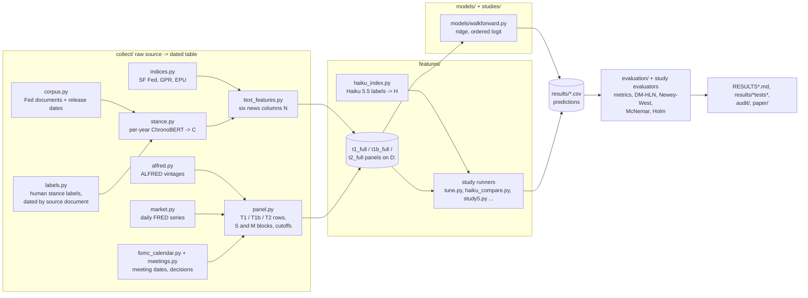

# Review map

How to audit this repository: what each file does, the order things run in, and which files produce each
table and figure. Every headline number of the draft paper is traced in
[`docs/reports/RESULTS_PROVENANCE.md`](RESULTS_PROVENANCE.md).

Layout as of 2026-10-17 (branch `review-layout`). Before that date every module sat directly in
`src/fed_news/`; the old names still import and run (table at the end). On 2026-10-18 the pre-registrations
(`PREREG*.md`) moved to `docs/prereg/`, the generated reports (`RESULTS*.md`) to `docs/reports/`, and the long
README to `docs/README_DETAILED.md`. In the tagged commits they are still at the repository root.

## 1. The pipeline

Plain-text version: **source** (FRED/ALFRED, federalreserve.gov, Hugging Face labels, FRASER) →
**dated tables** (`collect/`, cached under `D:/fed_news`) → **stance score** per document (`features/stance.py`
for ChronoBERT, `features/haiku_index.py` for Haiku) → **feature row** per month or meeting
(`features/text_features.py` + `features/panel.py`) → **walk-forward fit** (`models/walkforward.py` or a study
runner) → **saved prediction** (`results/**/preds_*.csv`) → **test** (`evaluation/stats_tests.py` and the study
evaluator) → **reported table** (`RESULTS*.md`, `audit/2026-10-13/AUDIT.md`, `paper/main.tex`).

## 2. One forecast followed end to end

The monthly ridge forecast for **June 2020** on the corrected cutoff. It supplies 78% of the headline monthly
text gain.

| Step | Where | What you can check |
| --- | --- | --- |
| Raw sources | `collect/alfred.py` (`asof_series`), `collect/market.py`, `collect/corpus.py` | ALFRED value used = latest vintage released before the cutoff; document release dates come from the Fed pages |
| Cutoff | `features/panel.py` (`second_business_day`, `build_t1b`) | Row 2020-06: cutoff 2020-06-02 00:00, text window from 2020-05-04; `fallback_n` = 0 (no revised statistic) |
| Stance per document | `features/stance.py` → `D:/fed_news/doc_stance.pkl` | Documents of 2020 are scored only by the 2020 classifier (backbone trained to Dec 2019, labels from documents dated before 2020-01-01). Six documents in the window: 5 speeches, 1 minutes (2020-05-20, stance −0.256) |
| Feature row | `features/text_features.py` (`fed_stance`) → `D:/fed_news/t1b_full.pkl` | `n_stance` = mean of the speech-group mean (−0.075) and the minutes mean (−0.256) = −0.166 |
| Model fit | `models/walkforward.py` (`run_spec`, `train_mask`), `models/linear.py` | Ridge on the rate change, trained on months up to April 2020 (t−2), penalty by expanding CV |
| Saved prediction | `results/post_audit_t1b/preds_T1_S.csv`, `preds_T1_S+N.csv` | 2020-06-01: actual 0.08, S forecast −1.411, S+N forecast −0.264 |
| Test and table | `audit/2026-10-13/rerun_plan1_t1b.py` → `results/post_audit_t1b/tests_T1_t1b.json` | DM-HLN p 0.103, RMSE 0.1919 → 0.1675; paper table `tab:linear` row 1 and figure `fig:cum` (`paper/make_figures.py`, `fig_cumgain`) |

Re-run this step yourself without touching `results/`: `python audit/verify_saved_outputs.py --quick`.

## 3. Run order

Commands are in `docs/README_DETAILED.md` section 13. In short, from the repository root with `PYTHONPATH=src`:

1. `collect`: `meetings`, `corpus`, `labels` (via `features.stance`), `indices`, `alfred` (via `features.panel`).
2. `features`: `panel` (T1, T2 panels) → `stance` (GPU, hours) → `text_features` (attaches N, writes `*_full.pkl`).
   Study 4 adds `features.haiku_index project|submit|collect` (paid API); Study 2 adds `studies.study2_regional.stance2`.
3. `studies.plan1_linear.run_models` → `evaluation.evaluate` (`docs/reports/RESULTS.md`).
4. Each later study's runner, then its evaluator (table below).

Raw data and caches live in `D:/fed_news` (or `FED_NEWS_DATA`); they are not in the repository.

**Note on the corrected monthly panel.** `D:/fed_news/t1b_full.pkl` (2026-10-13 00:53, commit e2b74a8) was built by
calling `features.panel.build_t1b_panel()` and then `features.text_features.attach_all(("t1b",))` from an
interactive session; no committed command runs these two calls. Its row cutoffs were checked afterwards
(`results/study4/v2_verification.json`: 393 months, 0 violations).

## 4. What each file does

### Shared pipeline

| File | Role | Writes |
| --- | --- | --- |
| `config.py` | Paths, windows, grids, seeds, the `prereg` tag name | – |
| `http.py` | GET with retries and an on-disk cache | `D:/fed_news/cache/` |
| `collect/market.py` | Target rate (spliced), effective rate, yields, VIX, oil | `market_daily.pkl`, `fedfunds.pkl` |
| `collect/alfred.py` | Every ALFRED vintage; `asof_series` gates by release date, conservative fallback before the first vintage | `alfred/<id>.pkl` |
| `collect/fomc_calendar.py` | Statement, minutes, press-conference and Beige Book links; minutes release dates | `calendar.pkl` |
| `collect/meetings.py` | One row per decision, scheduled and unscheduled; decision class | `meetings.pkl` |
| `collect/corpus.py` | Fed documents with the date each became public | `corpus.pkl` |
| `collect/indices.py` | SF Fed news sentiment, GPR, EPU (current vintages) | `indices.pkl` |
| `collect/labels.py` | Trillion Dollar Words + World Central Banks labels, dated by earliest containing document | `labels.pkl` |
| `collect/fraser.py`, `collect/regional_corpus.py` | Study 2 regional presidents' speeches | `regional_corpus.pkl` |
| `features/panel.py` | T1 (1st calendar day), T1b (2nd business day) and T2 (day before meeting) rows; S and M blocks; `fallback_n` | `t1.pkl`, `t1b.pkl`, `t2.pkl` |
| `features/stance.py` | Per-year ChronoBERT classifiers, held-out accuracy, document stance C | `doc_stance.pkl`, `results/stance_accuracy.csv` |
| `features/text_features.py` | Six news columns N; attaches them to the panels | `t1_full.pkl`, `t2_full.pkl`; `t1b_full.pkl` (see note below) |
| `features/haiku_index.py` | Haiku 5.5 sentence labels (masked, batched) and document stance H | `doc_stance_haiku.pkl`, `study4/sentence_labels.pkl`, `results/study4/haiku_index.json` |
| `models/linear.py` | Ridge, penalised ordered logit, Taylor rule, penalty CV, move sizes | – |
| `models/walkforward.py` | Ladder of specs, t−2 rule, placebo and shuffled controls, refuses news rows without tag `prereg` | predictions (via callers) |
| `models/neural.py`, `models/tft.py` | LSTM / GRU regressors, TFT-inspired network, training loops | – |
| `evaluation/stats_tests.py` | DM-HLN, exact McNemar, Holm | – |
| `evaluation/evaluate.py` | Metrics, H1 decision | `docs/reports/RESULTS.md`, `results/metrics.csv`, `results/h1_tests.csv` |
| `evaluation/clark_west.py` | Clark–West for nested models (exploratory) | `results/exploratory/clark_west.csv` |
| `evaluation/robustness.py` | Post-review checks of 2026-10-11 | `results/exploratory/*.csv` |
| `evaluation/plots.py` | README figures | `figures/*.png` |

### Studies

| Folder | Status | Runner → evaluator | Results | Report |
| --- | --- | --- | --- | --- |
| `studies/plan1_linear/` | Registered, tag `prereg` | `run_models.py` → `evaluation/evaluate.py` | `results/preds_T*.csv`, `metrics.csv`, `h1_tests.csv`, `h2_pvalues.csv` | `docs/reports/RESULTS.md` |
| `studies/plan2_neural_original/` | Registered, tag `prereg-h2a`; **original** networks | `run_neural.py` → `evaluate_h2a.py`; `frozen.py`; `diag_tft.py` | `results/h2a/`, `results/frozen/`, `results/h2a_diag/` | `docs/reports/RESULTS_H2A.md`, `docs/reports/RESULTS_FROZEN.md` |
| `studies/plan5_event_study/` | Registered, tag `prereg-text` | `event_study.py`, `market_bench.py`, `ablation.py`, `naive_stance.py` → `evaluate_text.py` | `results/text/` | `docs/reports/RESULTS_TEXT.md` |
| `studies/study2_regional/` | Registered, tag `prereg-study2` | `stance2.py` → `study2.py`, `study2_frozen.py` → `evaluate_study2.py` | `results/study2/` | `docs/reports/RESULTS_STUDY2.md`, `docs/reports/RESULTS_STUDY2_FROZEN.md` |
| `studies/study3_decision_text/` | Proof of concept, failed its pre-set check | `study3.py` → `evaluate_study3.py` | `results/study3/` | (none committed) |
| `studies/poc/` | Exploratory proofs of concept | `poc_*.py`, `stmt_change.py` | `results/poc_*` | `docs/reports/RESULTS_POC.md` (written by hand from the files) |
| `studies/study4_haiku_logit/` | Exploratory study; design b4a00fd before the run | `haiku_compare.py`; `study4_sensitivity.py` | `results/study4/` (top level), `results/study4/sensitivity/` | `docs/reports/RESULTS_STUDY4.md` (written by hand from the files) |
| `studies/study4_networks_v2/` | **Amended** (v2 protocol 6048e0d, after v1 results); v1 superseded | `verify_v2.py` → `tune.py time/tune/forecast`; `study4_pooled.py` | `results/study4/neural/` (T2), `results/study4/neural_t1/` (T1); v1 in `results/study4/superseded_v1/` | `docs/reports/RESULTS_STUDY4.md`, audit section 2 |
| `studies/study5_horizon/` | Exploratory study; design 85de61f before the run | `study5.py` | `results/study5/` | `docs/reports/RESULTS_STUDY5.md` (written by hand from the files) |
| `audit/2026-10-13/` | Post-results audit | `recompute.py`, `rerun_plan1_t1b.py` | `recomputed_*.csv`, `results/post_audit_t1b/` | `AUDIT.md` |

**Original vs amended networks.** `results/h2a/` is Plan 2 (paper-style settings, original monthly cutoff,
S vs S+N). `results/study4/neural*/` is Study 4 **version 2** (tuned, corrected cutoff, Haiku and ChronoBERT).
`results/study4/superseded_v1/` must not be cited. Each folder has a README stating its status.

**Mixed vs strict real-time.** In the v2 folders the inputs are named in every file name: `S`, `S+M`, `+H`,
`+C` are mixed vintage; `strict*` are strictly real-time; `placebo-*` are controls.

## 5. Tables and figures: which file makes them

| Output | Made by | From |
| --- | --- | --- |
| `docs/reports/RESULTS.md` | `evaluation/evaluate.py` | `results/preds_T*.csv` |
| `docs/reports/RESULTS_H2A.md`, `docs/reports/RESULTS_FROZEN.md` | `studies/plan2_neural_original/evaluate_h2a.py`, `frozen.py` | `results/h2a/`, `results/frozen/` |
| `docs/reports/RESULTS_TEXT.md` | `studies/plan5_event_study/evaluate_text.py` | `results/text/` |
| `docs/reports/RESULTS_STUDY2.md`, `docs/reports/RESULTS_STUDY2_FROZEN.md` | `studies/study2_regional/evaluate_study2.py`, `study2_frozen.py` | `results/study2/` |
| `docs/reports/RESULTS_STUDY4.md`, `docs/reports/RESULTS_STUDY5.md`, `docs/reports/RESULTS_POC.md` | written by hand (by the AI agent) from the result files | `results/study4/`, `results/study5/`, `results/poc_*` |
| `audit/2026-10-13/AUDIT.md` tables | `audit/2026-10-13/recompute.py`, `rerun_plan1_t1b.py` | saved predictions |
| `figures/fig1`–`fig7` (README) | `evaluation/plots.py` | saved predictions |
| `paper/figures/fig_rates.pdf`, `fig_cumgain.pdf`, `fig_forest.pdf` | `paper/make_figures.py` | `results/post_audit_t1b/`, `audit/2026-10-13/recomputed_comparisons.csv` |
| Paper tables | typed into `paper/main.tex` from the files in `docs/reports/RESULTS_PROVENANCE.md` | – |

## 6. Old module names

`import fed_news.<old>` and `python -m fed_news.<old>` still work and run the moved code
(`src/fed_news/__init__.py`, tested in `tests/test_layout.py`). Use the new names in new work.

| Old (until 2026-10-17) | New |
| --- | --- |
| `alfred`, `corpus`, `fomc_calendar`, `fraser`, `indices`, `labels`, `market`, `meetings`, `regional_corpus` | `collect.<name>` |
| `panel`, `stance`, `text_features`, `haiku_index` | `features.<name>` |
| `models` | `models.linear` (`fed_news.models` is now the package and re-exports it) |
| `walkforward`, `neural`, `tft` | `models.<name>` |
| `stats_tests`, `evaluate`, `clark_west`, `plots`, `robustness` | `evaluation.<name>` |
| `run_models` | `studies.plan1_linear.run_models` |
| `neural_walk`, `run_neural`, `evaluate_h2a`, `frozen`, `diag_tft` | `studies.plan2_neural_original.<name>` |
| `events`, `event_study`, `naive_stance`, `ablation`, `market_bench`, `evaluate_text` | `studies.plan5_event_study.<name>` |
| `stance2`, `study2`, `study2_frozen`, `evaluate_study2` | `studies.study2_regional.<name>` |
| `decision_embed`, `decision_text`, `study3`, `evaluate_study3` | `studies.study3_decision_text.<name>` |
| `haiku_compare`, `study4_sensitivity` | `studies.study4_haiku_logit.<name>` |
| `tune`, `verify_v2`, `study4_pooled` | `studies.study4_networks_v2.<name>` |
| `study5` | `studies.study5_horizon.study5` |
| `stmt_change`, `poc_stmt`, `chronogpt`, `poc_scorer`, `poc_finetune`, `poc_llm_labels`, `poc_haiku_leak`, `poc_haiku_memory` | `studies.poc.<name>` |

Historical records (pre-registrations, `RESULTS*.md`, `DEVIATIONS.md`, `audit/`, commit messages, git tags) keep
the old names on purpose; they describe the code as it was when they were written. `git log --follow <new path>`
shows a file's full history across the move.

## 7. What a reviewer cannot check from the repository alone

- **Raw data and caches** (`D:/fed_news`, several hundred MB, partly third-party text) are not committed;
  `results/data_hashes.txt` gives their hashes at the Plan 1 run.
- **GPU steps** (ChronoBERT classifiers, Study 2 retraining, networks) need CUDA and hours of compute; their
  outputs are committed, but re-running them was not part of the 2026-10-17 check.
- **Paid API steps**: Haiku's 343,742 sentence labels (`study4/sentence_labels.pkl`) are local only; the
  document scores derived from them are summarised in `results/study4/haiku_index.json`.
- **Run logs** (`logs/`) are git-ignored and exist only on the original machine.
- **Who decided what**: every commit was made by the AI agent; the human's decisions appear only where a commit
  message or design document records them.
